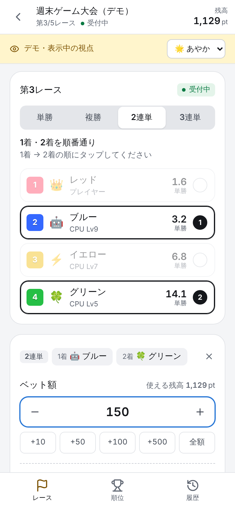
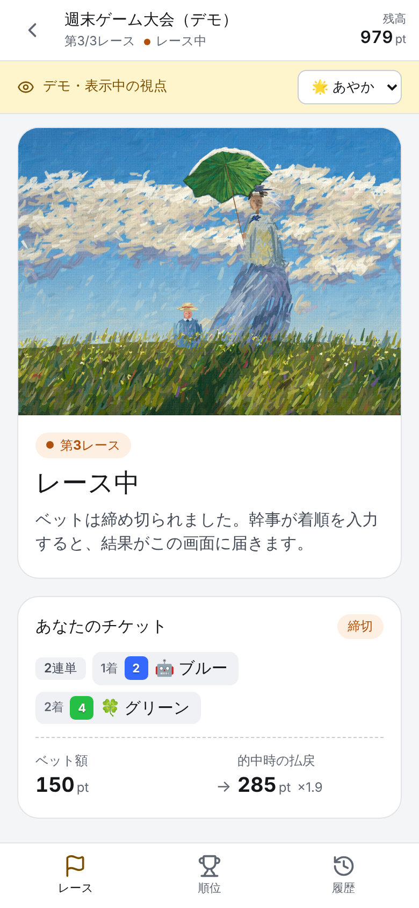
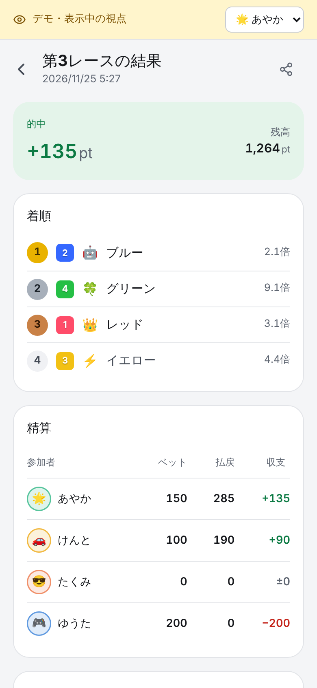
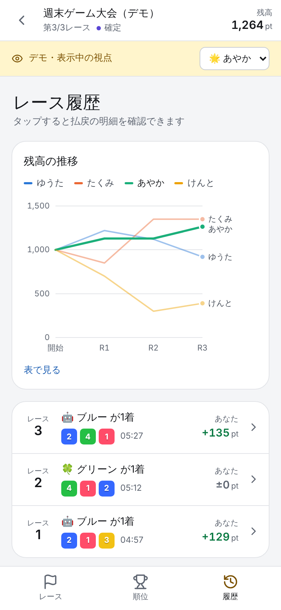
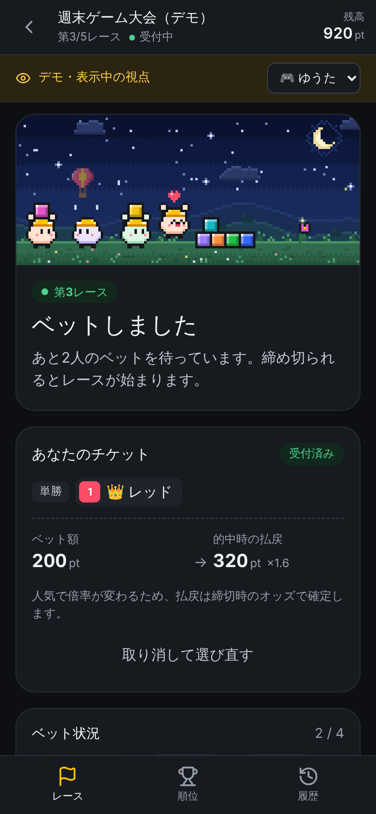

# ランクパーティ

[](https://github.com/shellcat7/party-bet-arena/actions/workflows/validate.yml)

ゲーム大会の勝負にオッズとベットを付けて、参加者全員の順位をリアルタイムに集計するWebアプリです。幹事がルームを作成してQRコードで招待し、参加者は各自のスマートフォンからベットします。着順を入力すると払戻が自動で計算され、全員の画面に反映されます。

https://shellcat7.github.io/party-bet-arena/

Firebaseに接続しなくても、「デモを見る」から幹事と参加者の両方の画面を確認できます。

ポイントは遊び用です。現金や景品のやり取りには使用できません。

| 進行（幹事） | ベット | レース中（参加者） | 着順入力 |
| --- | --- | --- | --- |
|  |  |  |  |
| **レース結果** | **履歴** | **最終結果** | **ダーク表示** |
|  |  |  |  |

## 機能

- ルームの作成と招待（12文字のルームIDと16文字の参加コード、QRコード、招待リンク）
- 単勝・複勝・2連単・3連単のベット。幹事による代行入力と取り消し
- 対戦者の強さからのオッズ自動計算と、ベットの集まり具合でオッズが変わるモード
- ベット受付 → 締切 → 着順入力 → 精算 の進行管理。確定前の精算プレビュー
- 進行に合わせて参加者の画面が切り替わる（ベット → 締切待ち → レース中 → 結果）。レース中はベットできない状態で待つ
- 幹事のレース中の画面から、ルール・対戦者・参加者・招待の準備に移れる
- 着順の訂正（直前の精算の取り消し）と、締切前のベットの取り消し
- 順位と変動、レース履歴、残高推移グラフ、最終結果
- 9言語（日本語、英語、中国語、韓国語、スペイン語、フランス語、ドイツ語、イタリア語、ウクライナ語）、ライトとダーク表示

## 構成

| 領域 | 使用技術 |
| --- | --- |
| フロントエンド | React 19、TypeScript（strict）、Vite |
| データ同期 | Firebase Realtime Database、Firebase Authentication（匿名ログイン） |
| 権限 | Realtime Database Security Rules（`firebase.rules.json`） |
| ホスティング | GitHub Pages（GitHub Actions でデプロイ） |
| テスト | Vitest、Firebase Emulator、Playwright、axe-core |

サーバー側のコードはありません。データの読み書きの可否はすべて Security Rules で判定しています。

```
src/
├── lib/         ドメインロジック（オッズ、ベット、精算、ルーム操作、同期用の差分生成）
├── state/       ルームの状態管理と画面遷移
├── screens/     画面
├── components/  共通UI
├── i18n/        翻訳の仕組みと各言語のカタログ
└── styles/      CSS（トークン、共通部品、画面別）
```

`lib/` は React と Firebase に依存しない関数のみで構成しており、ユニットテストの対象です。設計の詳細は [docs/ARCHITECTURE.md](docs/ARCHITECTURE.md) にまとめています。

## 実装上の判断

**同時書き込み時のデータ保護**
幹事の変更はルーム全体を上書きせず、変更されたパスだけを書き込みます（`src/lib/patch.ts`）。締切・精算・次のレースへの移行は Realtime Database のトランザクションで実行し、サーバー上の最新状態を前提に処理します。複数のタブや古い表示から操作しても、精算済みのレースを再度精算したり、締切直前に受け付けたベットを取りこぼしたりしません。

**サーバーを持たない権限管理**
Security Rules で次の制約を課しています。参加コードが一致した端末だけがメンバーとして登録でき、メンバー以外はルームを読めません。参加者が作成できるのは、初期残高の自分のレコードと、受付中の自分のベット1件だけです。倍率はクライアントから受け取らず、精算時に毎回計算します。ルールのテストはエミュレータ上で実行しています（`tests/firebase-rules.test.ts`）。

**オッズの計算**
すべての券種を1つの確率モデル（Plackett–Luce）から計算し、`払戻率 ÷ 的中確率` で倍率を決めています。どの券種を買っても平均の払戻率がそろい（自動オッズでは90%）、期待値が賭け金を上回る券種はありません。テストで券種ごとの払戻率を確認しています。

**待ち時間の絵**
締切待ちの画面にはピクセルアートのアニメーション（`src/components/scenes/PixelCarriers.tsx`）、レース中の画面にはモネの「散歩、日傘をさす女性」（1875年、パブリックドメイン）の筆致と色合いを参考にした風景（`src/components/scenes/meadowPainter.ts`）を表示します。どちらも画像ファイルを使わず、Canvas にコードで描いています。風景は乱数のシードから筆の一筆ずつを生成し、動かない層はキャッシュして、風で揺れる草やベールだけを毎フレーム描き直します。画面外やタブが非表示のときは停止し、「視差効果を減らす」設定では静止画になります。風景のコードはレース中に初めて読み込みます。

**多言語対応**
日本語・英語・中国語（簡体字）・韓国語・スペイン語・フランス語・ドイツ語・イタリア語・ウクライナ語に対応しています。英語の原文をキーにしたカタログ方式で、複数形は ICU 形式で表現します。翻訳漏れはテストで検出します。

## 開発

Node.js 22 以上が必要です。

```bash
npm install
npm run dev
```

Firebase の設定がない場合は、端末内だけで動作するモードで起動します。

| コマンド | 内容 |
| --- | --- |
| `npm run check` | 型チェック、Lint、ユニットテスト、ビルド |
| `npm test` | ユニットテスト（`npm run test:coverage` でカバレッジ） |
| `npm run test:rules:emulator` | Security Rules のテスト（Java 21 が必要） |
| `npm run test:e2e` | 本番ビルドに対する E2E テストとアクセシビリティ検査 |
| `npm run test:e2e:online` | Firebase Emulator を使った2端末の E2E テスト |

プルリクエストでは、これらすべてを GitHub Actions で実行します。

### Firebase Emulator で複数端末を試す

`npm run dev:emulators` を起動したうえで、`.env.local` に次の値を設定して `npm run dev` を実行します。本番の Firebase には接続しません。

```dotenv
VITE_FIREBASE_API_KEY=demo-key
VITE_FIREBASE_APP_ID=1:123:web:123
VITE_FIREBASE_AUTH_DOMAIN=demo-party-bet-security.firebaseapp.com
VITE_FIREBASE_DATABASE_URL=https://demo-party-bet-security-default-rtdb.firebaseio.com
VITE_FIREBASE_PROJECT_ID=demo-party-bet-security
VITE_USE_FIREBASE_EMULATORS=true
```

## デプロイ

1. Firebase Console で Web アプリを登録し、Realtime Database と匿名ログインを有効にします。
2. GitHub の Repository variables に `VITE_FIREBASE_*` を設定します。これらはブラウザに配布される値です。
3. Settings → Pages で Source を GitHub Actions に設定します。`main` への push でデプロイされます。
4. `firebase.rules.json` を Firebase に反映します。クライアントとの公開順序は [docs/SECURITY.md](docs/SECURITY.md) を参照してください。

## ドキュメント

- [docs/ARCHITECTURE.md](docs/ARCHITECTURE.md)：データモデル、同期、レースの状態遷移、オッズ
- [docs/SECURITY.md](docs/SECURITY.md)：権限モデル、既知の制約、リリース手順
