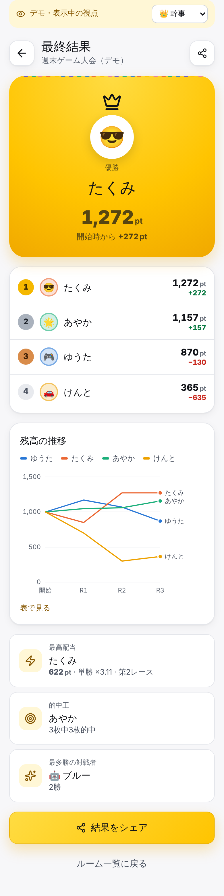
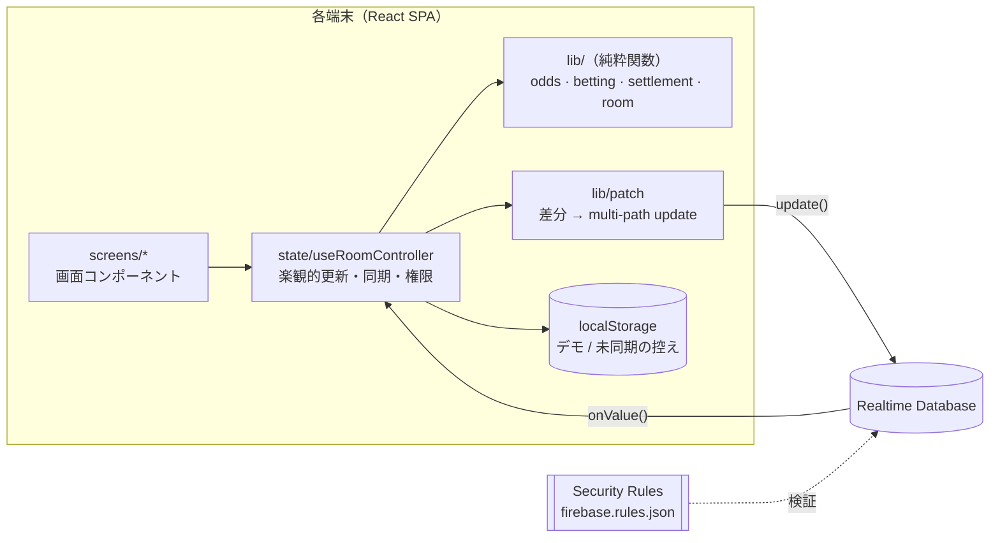

<div align="center">


# ランクパーティ（Party Bet Arena）

**いつもの勝負を、賭けて盛り上がろう。**<br />
身内のゲーム大会に、競馬のようなオッズとベット、リアルタイムのランキングを持ち込むWebアプリです。

[](https://github.com/shellcat7/party-bet-arena/actions/workflows/deploy.yml)


**[▶ アプリを開く](https://shellcat7.github.io/party-bet-arena/)** ・ 登録不要。「デモで試す」から1台で幹事と参加者の両方を体験できます。

</div>

<p align="center">
  
  
  
  
</p>

> 遊び用コインだけを扱う身内向けツールです。現金・換金・景品のやり取りには使えません。

## どんなアプリか

対戦ゲーム、カラオケ、ボードゲーム…友だち同士の勝負を「観る側」も楽しめるようにするアプリです。

1. **幹事がルームを作り、QRコードで招待**します。アカウント登録は不要です。
2. 参加者は**自分のスマホで単勝・複勝・2連単・3連単にベット**します。スマホがない人は幹事が代行入力できます。
3. 勝負が終わったら幹事が**着順をタップするだけで自動精算**。結果とランキングが全員の画面に即座に反映されます。
4. 全レースが終わると、**優勝者・残高推移グラフ・ハイライト**を表示します。

## 主な機能

| 領域 | 機能 |
| --- | --- |
| ルーム | 12文字のルームID＋16文字の参加コード（暗号学的乱数）、QR／リンク招待、招待QRの写真からの読み取り、最近のルーム一覧、リロード時の自動再接続 |
| ベット | 4券種、対戦者の強さ（CPUレベル）からのオッズ自動計算、人気でオッズが動くパリミュチュエル方式、残高チェック、幹事による代行入力と取り消し |
| 進行 | 受付中 → 締切 → 精算の3段階フロー、確定前の精算プレビュー、最終レース判定 |
| 結果 | 参加者ごとの的中演出、払戻明細、順位変動（▲▼）、レース履歴、残高推移グラフ（ホバー／タップで値、表でも確認可） |
| 体験 | 日本語／英語、ライト／ダーク／端末設定、ブラウザの戻るボタン対応、オフライン表示、デスクトップでの2カラム表示、OGP |

## 技術スタック

- **フロントエンド**: React 19 / TypeScript（strict）/ Vite 7。状態管理ライブラリは使わず、ドメインロジックを純粋関数に分離して React は表示と配線に専念させています。
- **バックエンド**: Firebase Realtime Database + Anonymous Auth。サーバーコードはなく、権限は **Security Rules** で表現しています。
- **ホスティング**: GitHub Pages（GitHub Actions でデプロイ）
- **品質**: Vitest（ユニット 96件）/ Firebase Emulator（ルール 10件）/ Playwright（E2E 8件、axe によるアクセシビリティ検査を含む）/ ESLint / Prettier

## アーキテクチャ



| ディレクトリ | 役割 |
| --- | --- |
| `src/lib/` | ドメインロジック。React にも Firebase にも依存しない純粋関数で、ユニットテストの対象 |
| `src/state/` | ルームの状態と操作（`useRoomController`）、履歴 API と連動するスタック型ナビゲーション |
| `src/screens/` | 画面。`room/` 配下はルーム内の各タブ・詳細画面 |
| `src/components/` | 共通 UI（トースト、確認シート、グラフ、フォーム部品） |
| `src/styles/` | デザイントークン → ベース → コンポーネント → 画面 の順に積んだ CSS |
| `firebase.rules.json` | 権限とデータ検証。クライアントと同じ PR でテストする |

詳しくは [docs/ARCHITECTURE.md](docs/ARCHITECTURE.md) を参照してください。

## 設計で工夫したこと

### 1. 同時に書き込んでもデータが消えない同期

以前の実装は、幹事が何かを変更するたびにルーム全体を `set()` で上書きしていました。そのため、**参加者がベットした直後に幹事がルーム名を1文字変えるだけで、そのベットが消える**競合がありました。

現在は、変更前後のルームを比較して**変わったパスだけ**を `update()` で書き込みます（`buildRoomPatch`）。参加者・ベットはレコード単位、新しいレースは丸ごと置き換え、という粒度で差分を取ります。古いコピーを持った幹事が書き込んでも参加者のベットが残ることを、エミュレータ上のルールテストで確認しています。

### 2. サーバーなしで不正を防ぐ

サーバーを持たない代わりに、Security Rules で「誰が・どこに・何を書けるか」を表現しています。

- 参加コードが一致したときだけメンバー登録でき、メンバーだけがルームを読める
- 参加者が作れるのは**初期残高ちょうどの自分のレコード**と、**受付中の自分のベット1枚**だけ
- 幹事が締め切るとベットは拒否される → 幹事は**締切後のサーバーの最新データ**から精算する
- 倍率はクライアントから受け取らず、精算時に毎回計算し直す

ただし、幹事は信頼される前提です（[docs/SECURITY.md](docs/SECURITY.md)）。

### 3. 遊べるオッズモデル

- 強さ（CPUレベル）を指数関数で重み付けして勝率を出し、そこから「公正なオッズ」を計算したうえで、大穴が一度で場を壊さないよう1倍側に圧縮しています。
- 2連単・3連単は Plackett–Luce モデルで着順の起こりやすさを評価し、番狂わせの順番ほど高配当になるよう補正しています。
- 「人気でオッズが動く」設定では、仮想プールを加えたパリミュチュエル方式で、最初の数枚のベットで倍率が極端に振れないようにしています。

### 4. 細部まで使えるUI

- 進行画面は**次にやるべき操作を1つだけ**大きく表示し、確定操作の前には精算プレビューと確認シートを出します。
- ブラウザの戻るボタン／iOS のスワイプで画面を戻れます（履歴 API と同期したスタックナビゲーション）。
- ライト・ダークの両方を個別に設計し、axe でコントラストを含む WCAG 2.1 AA の自動検査を通しています。グラフの配色は色覚多様性に配慮して検証済みです。
- Content Security Policy で外部スクリプトを禁止しています（この制約で見つかった Firebase Auth の不要なスクリプト読み込みも解消済み）。

## テスト

| コマンド | 内容 |
| --- | --- |
| `npm test` | ドメインロジックのユニットテスト（オッズ、的中判定、精算、差分生成、正規化、ストレージ）。カバレッジは `npm run test:coverage` |
| `npm run test:rules:emulator` | Realtime Database エミュレータでのルールテスト（権限・検証・同時書き込み） |
| `npm run test:e2e` | 本番ビルドに対する E2E（2レースの大会を最後まで進行、デモ、英語切替、ライト／ダークでの axe 検査、横スクロールなし） |
| `npm run test:e2e:online` | Auth + Database エミュレータでの2ブラウザ E2E（QR を画像として読み取って参加 → ベット → 幹事の精算が参加者に即時反映 → リロード復帰） |
| `npm run check` | 型チェック・Lint・ユニットテスト・ビルド |

プルリクエストでは GitHub Actions がこれらすべてを実行します（`.github/workflows/validate.yml`）。

## ローカルで動かす

```bash
npm install
npm run dev          # http://localhost:5173/party-bet-arena/
```

Firebase の設定がない場合は、この端末だけで完結するモード（デモ・幹事による代行入力）で動きます。

### Firebase エミュレータで複数端末を試す

Java 21 が必要です。本番の Firebase には一切書き込みません。

```bash
npm run dev:emulators   # 別ターミナルで
```

`.env.local` に次の**エミュレータ専用**の値を入れて `npm run dev` を起動し、2つのブラウザ（またはシークレットウィンドウ）で開きます。

```dotenv
VITE_FIREBASE_API_KEY=demo-key
VITE_FIREBASE_APP_ID=1:123:web:123
VITE_FIREBASE_AUTH_DOMAIN=demo-party-bet-security.firebaseapp.com
VITE_FIREBASE_DATABASE_URL=https://demo-party-bet-security-default-rtdb.firebaseio.com
VITE_FIREBASE_PROJECT_ID=demo-party-bet-security
VITE_USE_FIREBASE_EMULATORS=true
```

## デプロイ

1. Firebase Console で Web アプリを追加し、Realtime Database と匿名ログインを有効にします。
2. GitHub の Repository **variables**（secrets ではなく）に `VITE_FIREBASE_*` を設定します。値はブラウザに配布される識別子で、防御の本体は Security Rules です。
3. Settings → Pages の Source を GitHub Actions にします。`main` に push すると、チェックを通過したビルドが公開されます。
4. ルールとクライアントは対で公開します。今回のリリースは**ルールが先**です（参加者レコードに任意項目 `joinedAt` を追加しており、新ルールは旧クライアントの書き込みもそのまま受け付けます）。手順は [docs/SECURITY.md](docs/SECURITY.md#リリース手順) にあります。

## ドキュメント

- [docs/ARCHITECTURE.md](docs/ARCHITECTURE.md) — データモデル、同期、レースのライフサイクル
- [docs/SECURITY.md](docs/SECURITY.md) — 脅威モデル、ルール、リリース手順、既知の制約
- [docs/archive/](docs/archive/) — 過去のデザインQA・セキュリティレビューの記録

---

<details>
<summary><strong>English summary</strong></summary>

**Rank Party** turns any friendly match — racing games, karaoke, board games — into a betting party with race-track odds and a live leaderboard. The host creates a room and shares a QR code; everyone bets from their own phone (win, place, exacta, trifecta); the host taps the finishing order and payouts are applied instantly on every device. Play coins only.

- React 19 + TypeScript (strict) + Vite, Firebase Realtime Database with anonymous auth, no server code
- Pure, unit-tested domain layer (odds model with Plackett–Luce ordering and a pari-mutuel pool, settlement, minimal multi-path sync patches)
- Security Rules enforce invitations, one bet per participant while betting is open, and immutable starting balances; tested against the emulator
- Playwright E2E including a two-browser emulator test that joins by decoding the rendered QR code, plus axe accessibility checks in light and dark themes
- Japanese and English UI, light/dark themes, browser back-button support, desktop layout

Try it without signing up: open the app and choose **Try the demo**.

</details>
