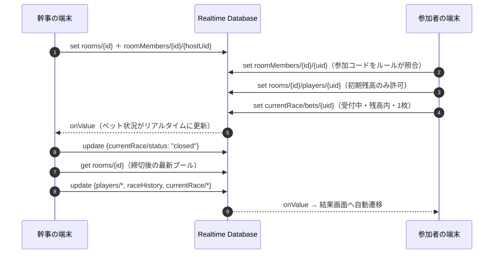

# アーキテクチャ

## 全体像

ランクパーティは静的サイト（GitHub Pages）として配信される React SPA です。複数端末の同期には Firebase Realtime Database を使い、サーバーコードは持ちません。

```
src/
├── lib/            ドメイン層：純粋関数（React・Firebase 非依存）
│   ├── odds.ts         オッズ計算・券種・倍率
│   ├── betting.ts      ベットの検証・作成・残高
│   ├── settlement.ts   的中判定・精算・ランキング・ハイライト
│   ├── room.ts         ルーム生成（通常／デモ）・各種変更・正規化
│   ├── patch.ts        差分から multi-path update を作る
│   ├── share.ts        共有シート／クリップボード
│   ├── storage.ts      localStorage（設定・セッション・一覧）
│   ├── ids.ts          ID生成・招待リンク
│   └── firebase.ts     Firebase SDK の薄いラッパー（遅延読み込み）
├── state/          状態と操作
│   ├── useRoomController.ts   ルーム・役割・同期・すべての操作
│   └── navigation.ts          履歴APIと同期するスタック型ナビゲーション
├── screens/        画面（room/ 配下はルーム内）
├── components/     共通UI
├── i18n/           日英の文言
└── styles/         tokens → base → components → screens
```

依存の向きは `screens → state → lib` の一方向です。`lib` は副作用を持たないため、ユニットテストで振る舞いを網羅できます（`src/lib/__tests__/`）。

## データモデル

Realtime Database 上の構造（主要部分）:

```
rooms/{roomId}
  id, schemaVersion: 2, hostUid, name, joinCode, startingBalance, settings{...}
  players/{playerId}        参加者（オンライン参加者は playerId = uid）
  contestants/{racerId}     対戦者（order で表示順を保持）
  currentRace
    id, number, status: "betting" | "closed" | "settled", resultIds[]
    bets/{betId}            本人のベットは betId = uid（1レース1枚をルールで強制）
  raceHistory[]             確定したレースのスナップショット（対戦者・チケット・精算）
roomMembers/{roomId}/{uid}  role, joinCode（参加コードの照合に使う）
```

- 配列ではなく**IDをキーにしたマップ**で保存し、端末ごとの書き込みが別パスになるようにしています。
- Realtime Database はキーの辞書順で返すため、表示順は `joinedAt`（参加者）と `order`（対戦者）で復元します。
- 読み込んだデータは必ず `normalizeRoom` を通します。欠けたコレクション（空のマップは保存されない）、古い形式のフィールド、数値の異常値をここで吸収します。

## 同期



### 通常の変更：楽観的更新と最小差分

ルーム名、参加者や対戦者の編集、設定変更などは `useRoomController` の `mutate(update)` で処理します。

1. 最新のルーム（`roomRef`）に純粋関数 `update` を適用し、すぐ画面に反映する
2. デモ／オフラインルームなら localStorage に保存して終わり
3. オンラインルームなら `buildRoomPatch(prev, next)` で変わったパスだけを `update()` する

`buildRoomPatch` は、参加者をフィールド単位、ベットをレコード単位で比較します。幹事の端末が参加者の新しいベットをまだ受信していなくても、そのベットを消すことはありません。古い表示から名前を変えても、残高が巻き戻ることもありません（`tests/firebase-rules.test.ts` で検証）。

### 進行操作：トランザクション

締切、受付再開、精算、次のレースへの移行、ポイント付与は、結果が残高に直結するため `transactRoom` で実行します。Realtime Database のトランザクションは常にサーバー上の現在の値に対して実行され、途中で値が変わると再試行されます。

各操作は「想定した状態でなければ null を返す」関数として `lib/settlement.ts` に定義しています（`closeBetting`、`reopenBetting`、`settleRace`、`advanceRace`）。たとえば別のタブがすでに精算していれば `settleRace` は null を返し、トランザクションは中止されます。これにより、二重精算、精算済みレースの再開、締切直前に受け付けたベットの取りこぼしを防いでいます。

### 精算

`settleRace` は締切と精算を1つのトランザクションで行います。サーバーが受け付けたベットはすべて精算の対象になり、締切後に届いたベットはルールで拒否されます。`settleRoom` はベットに保存された倍率を使わず、締め切ったプールから計算し直します。対戦者が少なく外れようがない券種（3人以下の複勝など）は無効として返金します。

### オフライン

- `.info/connected` を購読してオフラインバナーを表示します。
- オフライン中の通常の変更は SDK がメモリ上のキューに入れ、再接続時に送ります。UI が待ち続けないよう12秒でタイムアウトして通知します。アプリを閉じるとキューは失われます。
- 進行操作（トランザクション）はオフラインでは実行しません。

## レースのライフサイクル

```
betting ──締め切る──▶ closed ──着順を確定──▶ settled ──次のレース──▶ betting（number + 1）
   ▲                    │
   └──受付を再開─────────┘
```

状態の移行はすべて前述のトランザクションで行います。最終レースが `settled` になると最終結果画面に進みます。参加者の端末は `currentRace.id` と `status` の変化を監視し、確定したら自分の結果へ、次のレースが始まったらベット画面へ自動で移動します。

## オッズ

| 段階 | 内容 |
| --- | --- |
| 自動オッズ | 強さ `level` から重み `exp((level − 5) × 0.36)` を求め、勝率 → 公正オッズ → `1 + (公正 − 1) × 0.32` に圧縮。上限は出走数に応じて 8〜20倍 |
| 券種 | 単勝 = オッズ、複勝 = 単勝の約52%（最低1.1倍）、2連単／3連単 = オッズの積 × 係数 × 着順補正 |
| 着順補正 | Plackett–Luce モデルで「その順番」の確率を全順列の平均と比べ、番狂わせほど高く（0.58〜1.85倍に制限） |
| 人気で変動 | 同じ券種のプールに仮想プールを足したパリミュチュエル方式。払戻率92%、券種ごとの上限あり |
| 券種の制限 | 複勝は4人以上、3連単は3人以上のときだけ選べる。精算時にも確認し、条件を満たさないチケットは返金する |

## UI

- 画面遷移は `useNavigation` のスタックで管理し、`history.pushState` と同期させてブラウザの戻る操作に対応しています。画面が変わるとスクロールを先頭に戻し、フォーカスを新しい内容に移します。
- 文言は `t("日本語", "English")` の形でコンポーネントの近くに書いています。2言語なら両方を並べて確認でき、翻訳漏れが型エラーになるためです。
- CSS はデザイントークン（色・角丸・影）を `:root` と `[data-theme="dark"]` に定義し、ライトとダークをそれぞれ設計しています。グラフの系列色は色覚多様性に配慮した順序で、ライト／ダークそれぞれの背景で検証しています。
