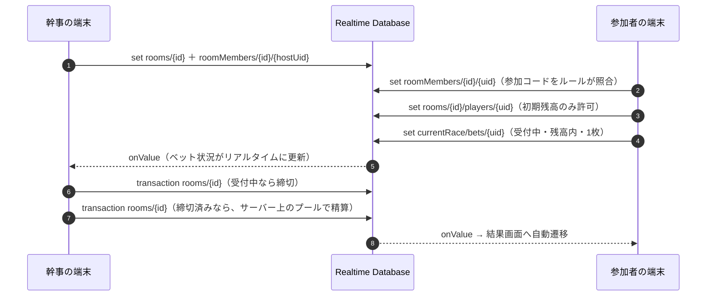

# アーキテクチャ

## 全体像

ランクパーティは静的サイト（GitHub Pages）として配信される React SPA です。複数端末の同期には Firebase Realtime Database を使い、サーバーコードは持ちません。

```
src/
├── lib/            ドメイン層：純粋関数（React・Firebase 非依存）
│   ├── odds.ts         オッズ計算・券種・倍率
│   ├── betting.ts      ベットの検証・作成・残高
│   ├── settlement.ts   的中判定・精算・ランキング・ハイライト
│   ├── room.ts         ルーム生成（通常／デモ）・各種変更・正規化
│   ├── patch.ts        差分から multi-path update を作る
│   ├── share.ts        共有シート／クリップボード
│   ├── storage.ts      localStorage（設定・セッション・一覧）
│   ├── ids.ts          ID生成・招待リンク
│   └── firebase.ts     Firebase SDK の薄いラッパー（遅延読み込み）
├── state/          状態と操作
│   ├── useRoomController.ts   ルーム・役割・同期・すべての操作
│   └── navigation.ts          履歴APIと同期するスタック型ナビゲーション
├── screens/        画面（room/ 配下はルーム内）
├── components/     共通UI
├── i18n/           翻訳の仕組みと各言語のカタログ
└── styles/         tokens → base → components → screens
```

依存の向きは `screens → state → lib` の一方向です。`lib` は副作用を持たないため、ユニットテストで振る舞いを網羅できます（`src/lib/__tests__/`）。

## データモデル

Realtime Database 上の構造（主要部分）:

```
rooms/{roomId}
  id, schemaVersion: 2, hostUid, name, joinCode, startingBalance, settings{...}
  players/{playerId}        参加者（オンライン参加者は playerId = uid）
  contestants/{racerId}     対戦者（order で表示順を保持）
  currentRace
    id, number, status: "betting" | "closed" | "settled", resultIds[]
    bets/{betId}            本人のベットは betId = uid（1レース1枚をルールで強制）
  raceHistory[]             確定したレースのスナップショット（対戦者・チケット・精算）
roomMembers/{roomId}/{uid}  role, joinCode（参加コードの照合に使う）
```

- 配列ではなく**IDをキーにしたマップ**で保存し、端末ごとの書き込みが別パスになるようにしています。
- Realtime Database はキーの辞書順で返すため、表示順は `joinedAt`（参加者）と `order`（対戦者）で復元します。
- 読み込んだデータは必ず `normalizeRoom` を通します。欠けたコレクション（空のマップは保存されない）、古い形式のフィールド、数値の異常値をここで吸収します。

## 同期



### 通常の変更：楽観的更新と最小差分

ルーム名、参加者や対戦者の編集、設定変更などは `useRoomController` の `mutate(update)` で処理します。

1. 最新のルーム（`roomRef`）に純粋関数 `update` を適用し、すぐ画面に反映する
2. デモ／オフラインルームなら localStorage に保存して終わり
3. オンラインルームなら `buildRoomPatch(prev, next)` で変わったパスだけを `update()` する

`buildRoomPatch` は、参加者をフィールド単位、ベットをレコード単位で比較します。幹事の端末が参加者の新しいベットをまだ受信していなくても、そのベットを消すことはありません。古い表示から名前を変えても、残高が巻き戻ることもありません（`tests/firebase-rules.test.ts` で検証）。

### 進行操作：トランザクション

締切、受付再開、精算、精算の取り消し、次のレースへの移行、ポイント付与は、結果が残高に直結するため `transactRoom` で実行します。Realtime Database のトランザクションは常にサーバー上の現在の値に対して実行され、途中で値が変わると再試行されます。

各操作は「想定した状態でなければ null を返す」関数として `lib/settlement.ts` に定義しています（`closeBetting`、`reopenBetting`、`settleRace`、`unsettleRace`、`advanceRace`）。たとえば別のタブがすでに精算していれば `settleRace` は null を返し、トランザクションは中止されます。これにより、二重精算、精算済みレースの再開、締切直前に受け付けたベットの取りこぼしを防いでいます。

### 精算

`settleRace` は締切と精算を1つのトランザクションで行います。サーバーが受け付けたベットはすべて精算の対象になり、締切後に届いたベットはルールで拒否されます。`settleRoom` はベットに保存された倍率を使わず、締め切ったプールから計算し直します。対戦者が少なく外れようがない券種（3人以下の複勝など）は無効として返金します。

### オフライン

- `.info/connected` を購読してオフラインバナーを表示します。
- オフライン中の通常の変更は SDK がメモリ上のキューに入れ、再接続時に送ります。UI が待ち続けないよう12秒でタイムアウトして通知します。アプリを閉じるとキューは失われます。
- 進行操作（トランザクション）はオフラインでは実行しません。

## レースのライフサイクル

```
betting ──締め切る──▶ closed ──着順を確定──▶ settled ──次のレース──▶ betting（number + 1）
   ▲                    │
   └──受付を再開─────────┘
```

状態の移行はすべて前述のトランザクションで行います。最終レースが `settled` になると最終結果画面に進みます。

精算後、次のレースを始める前であれば、幹事は精算を取り消して着順を入力し直せます（`unsettleRace`）。残高は精算で動いた分だけ戻し（その後に付与したポイントは残る）、チケットを元に戻してレースを締切状態に戻します。参加者の端末は `currentRace.id` と `status` の変化を監視し、確定したら自分の結果へ、次のレースが始まったらベット画面へ自動で移動します。

## オッズ

すべての券種を1つの確率モデルから計算し、どの券種を買っても平均的な払戻率がそろうようにしています（`src/lib/odds.ts`）。

| 段階 | 内容 |
| --- | --- |
| 強さ | 自動オッズでは強さ（レベル1〜11）から重み `exp((level − 5) × 0.36)` を求める。手動オッズでは、幹事が入力した単勝オッズの逆数を強さとみなす |
| 着順の確率 | Plackett–Luce モデル。1着を強さに比例して選び、残りから2着、3着…と順に選ぶ |
| 単勝 | 自動オッズでは `払戻率 ÷ 勝率`（払戻率90%）。手動オッズでは入力値をそのまま使う |
| 複勝・2連単・3連単 | `払戻率 ÷ 的中確率`。払戻率は単勝オッズから逆算した値（`1 ÷ Σ 1/オッズ`、50〜95%に制限）を使い、単勝と整合させる |
| 表示 | 0.1倍単位で切り捨て。最低1.0倍（元返し）、券種ごとに上限あり（単勝99倍、複勝30倍、2連単300倍、3連単1000倍） |
| 人気で変動 | 同じ券種のプールに、モデルのオッズで値付けした仮想プールを加えたパリミュチュエル方式。払戻率はモデルと同じ |
| 券種の制限 | 複勝は4人以上、3連単は3人以上のときだけ選べる。精算時にも確認し、条件を満たさないチケットは返金する |

以前の計算式は単勝の払戻率が約50%、2連単が23〜36%で、穴馬の複勝だけが100%を超えていました。現在は、端の値（1.0倍の元返しと上限）を除き、すべての券種で80〜95%に収まることをテストで確認しています（`src/lib/__tests__/odds.test.ts`）。

## UI

- 参加者の「レース」タブはレースの状態だけで表示が決まります（`PlayerRaceScreen`）。受付中でチケットがなければベット、あれば締切待ち（取り消し可）、締切後は操作のない「レース中」、確定後は結果と次のレース待ち。幹事が締め切ると、ほかのタブを見ている参加者もこの画面に移動します。状態ごとの色（受付中＝緑、レース中＝オレンジ、確定＝紫）はタグ・ステップ表示・ステータスの点で共通です。
- 待ち時間の絵は Canvas に描きます。ピクセルアート（`PixelCarriers`）は低解像度のキャンバスを整数倍で拡大し、スプライトは文字列で定義しています。風景（`PainterlyMeadow` / `meadowPainter.ts`）はシード付きの乱数で筆致を生成し、約8msずつに分けて描くのでメインスレッドを長く止めません。どちらも画面外・非表示のタブでは停止し、`prefers-reduced-motion` では静止画です。風景は `React.lazy` でレース中に初めて読み込みます。
- 画面遷移は `useNavigation` のスタックで管理し、`history.pushState` と同期させてブラウザの戻る操作に対応しています。画面が変わるとスクロールを先頭に戻し、フォーカスを新しい内容に移します。
- 文言は `t("日本語", "English", params)` の形でコンポーネントの近くに書いています。日本語と英語が原文で、ほかの7言語（中国語・韓国語・スペイン語・フランス語・ドイツ語・イタリア語・ウクライナ語）は英語の原文をキーにしたカタログ（`src/i18n/locales/`）から引きます。差し込み値は `{name}`、複数形は ICU 形式（`{count, plural, one {...} other {...}}`）で、ウクライナ語のような複数の複数形にも対応しています。カタログは選択中の言語だけを読み込みます。コードから使われている文言をすべて抽出し、各カタログに漏れや余分がないかをテストで確認しています（`src/i18n/__tests__/catalogs.test.ts`）。
- CSS はデザイントークン（色・角丸・影）を `:root` と `[data-theme="dark"]` に定義し、ライトとダークをそれぞれ設計しています。グラフの系列色は色覚多様性に配慮した順序で、ライト／ダークそれぞれの背景で検証しています。
